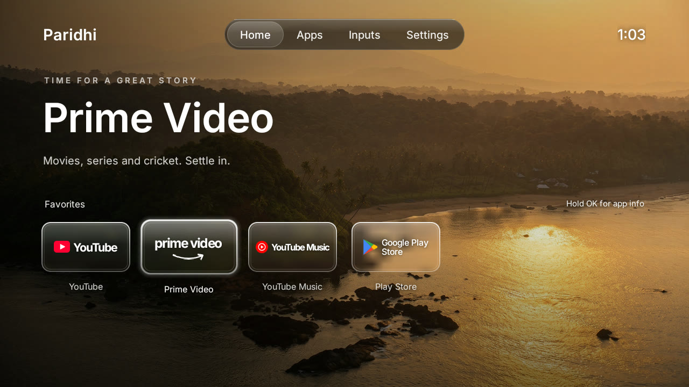
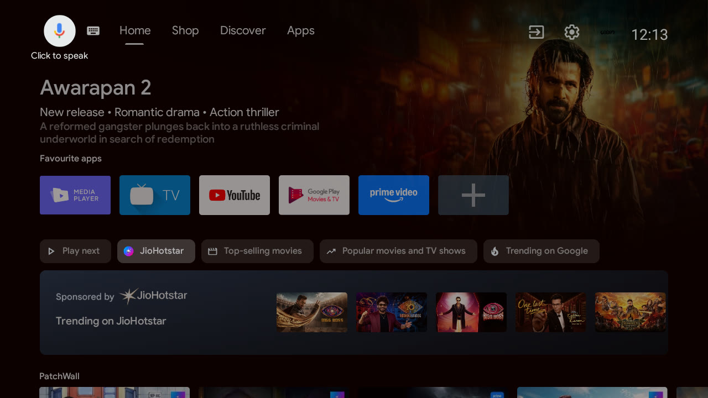
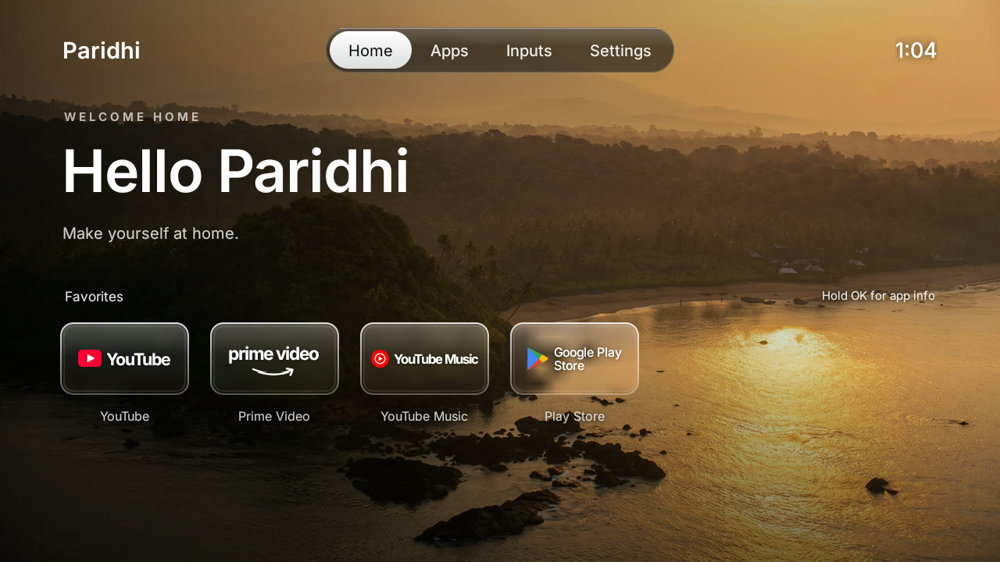
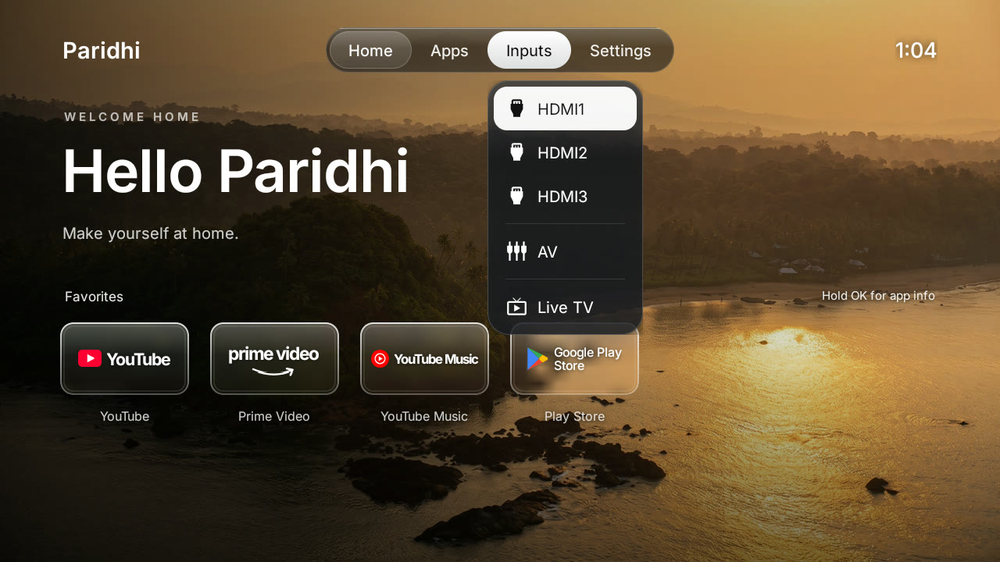

# xiaomi-tvhack

**A Xiaomi Mi TV without the ads.** Strip the bloatware from a Xiaomi Android TV over Wi-Fi and
replace the ad-filled home screen with a clean, glassy launcher. No root, no cable, and every step
can be undone.



| Before: stock home with a sponsored row | After: welcome screen |
|---|---|
|  |  |

Built and tested on a **Xiaomi MiTV4I** (codename magnolia, Android TV 9). It is based on
[tv-vibehack](https://github.com/Gathin23/tv-vibehack) by Gathin23 (MIT), adapted for Windows and
this TV, with a redesigned launcher.

## Contents

- [What you get](#what-you-get)
- [Requirements](#requirements)
- [Installation](#installation)
- [Customising](#customising)
- [Undoing everything](#undoing-everything)
- [Remote control without ADB](#remote-control-without-adb)
- [Troubleshooting](#troubleshooting)
- [Project layout](#project-layout)
- [Credits and licences](#credits-and-licences)

## What you get

- **A full-screen wallpaper** of your choice with a soft fade so text stays readable.
- **A liquid-glass tab bar**: Home, Apps, Inputs and Settings, with the clock on the right.
- **A hero** for the focused app: a small caps line, its name in large type and a tagline. With
  focus on the tabs it greets you instead ("Hello Paridhi").
- **A Favorites row of frosted glass tiles**: each tile shows a blurred patch of the wallpaper
  behind it, a bright rim, and the app's mark with a white wordmark.
- **One glass focus lens** that glides between tiles on a spring.
- **Inputs menu** for HDMI 1–3, AV and Live TV, using Android's TV input framework.
- **No ads, no sponsored rows, no Xiaomi analytics, no partner apps pushed onto the TV.**



The launcher is a small native Android app (`com.gathin.tvhome`) in plain Java. It's built for
1 GB TVs: no live blur, no video, no network access, no background services.

## Requirements

- A Xiaomi / Redmi **Android TV** (other Android TV and Google TV sets work too; package names differ).
- A **Windows PC** on the same Wi-Fi network as the TV.
- **Android platform tools** (`adb`):
  ```powershell
  winget install Google.PlatformTools
  ```
- To build the launcher: **JDK 17** and the **Android SDK** (platform 34, build-tools 34.0.0).
  ```powershell
  winget install EclipseAdoptium.Temurin.17.JDK
  ```
  Then either install Android Studio, or install the command-line tools into
  `%LOCALAPPDATA%\Android\Sdk\cmdline-tools\latest` and run:
  ```powershell
  sdkmanager --sdk_root=$env:LOCALAPPDATA\Android\Sdk --licenses
  sdkmanager --sdk_root=$env:LOCALAPPDATA\Android\Sdk "platforms;android-34" "build-tools;34.0.0"
  ```

## Installation

### 1. Turn on USB debugging on the TV

1. **Settings → Device Preferences → About**.
2. Scroll to **Build** and press **OK** seven times until it says *"You are now a developer"*.
3. Go back to **Device Preferences → Developer options** and turn on **USB debugging**.
4. Restart the TV (hold the power button → **Restart**). On Xiaomi sets, network ADB on port 5555
   only starts after a reboot.

Find the TV's IP address under **Settings → Network & Internet**, or in your router's device list.
The examples below use `192.168.1.18`; replace it with yours.

### 2. Connect from the PC

```powershell
git clone https://github.com/skparidhi/xiaomi-tvhack.git
cd xiaomi-tvhack
adb connect 192.168.1.18:5555
```

The TV shows **"Allow USB debugging?"**. Tick **Always allow from this computer** and press **OK**.
Check that it worked:

```powershell
adb devices
```

You should see `192.168.1.18:5555   device`.

### 3. Back up (recommended)

```powershell
mkdir backup
adb shell pm list packages -f > backup\packages.txt
adb shell pm list packages -d > backup\disabled.txt
adb shell settings list secure > backup\settings-secure.txt
adb shell settings list global > backup\settings-global.txt
```

### 4. Debloat

Read [`examples/xiaomi-mitv4i/debloat.txt`](examples/xiaomi-mitv4i/debloat.txt) first and comment
out anything you want to keep, then apply it:

```powershell
$env:TV_HOST = "192.168.1.18"
powershell -ExecutionPolicy Bypass -File tools\disable.ps1 examples\xiaomi-mitv4i\debloat.txt
```

Packages are **disabled** for your user (`pm disable-user`), never deleted from the system image.
This list disables PatchWall, the recommendation rows, TV Manager, the update service, Mi Cast,
Mi Music and Mi Gallery. Voice search and Chromecast are left on.

On this TV, the partner apps and telemetry were also removed for the user profile with
`pm uninstall --user 0`; [`removed-packages.txt`](removed-packages.txt) lists them and shows how to
bring each one back.

### 5. Set up the launcher

Edit [`launcher/app/src/main/res/values/config.xml`](launcher/app/src/main/res/values/config.xml):
the Favorites order (`dock_apps`), per-app hero text (`hero_text`), hidden apps and the Live TV app.
Put your name in [`strings.xml`](launcher/app/src/main/res/values/strings.xml) (`wordmark`,
`welcome_title`).

### 6. Build and install

```powershell
powershell -ExecutionPolicy Bypass -File launcher\build-and-install.ps1 -TvHost 192.168.1.18
```

This builds the APK, installs it, makes it the default home screen and only then disables the stock
Google TV launcher. If the install or the home switch fails, the stock launcher is left alone.
Press **Home** on the remote to see the new launcher.

## Customising

| Change | Where |
|---|---|
| Wallpaper | Replace `launcher/app/src/main/res/drawable-nodpi/wallpaper.jpg` with a 1280×720 JPEG |
| Favorites order | `dock_apps` in `values/config.xml` |
| Hero line and tagline per app | `hero_text` in `values/config.xml` (`package|eyebrow|tagline`) |
| Hidden apps | `hidden_apps` in `values/config.xml` |
| Name and greeting | `wordmark`, `welcome_title` in `values/strings.xml` |
| Tile logos | `bindLogo()` in `AppAdapter.java`; marks are vector drawables `res/drawable/ic_logo_*.xml` |
| Font | `res/font/inter.ttf` ([Inter](https://rsms.me/inter/), a free Helvetica-style typeface) |

Re-run `launcher\build-and-install.ps1` after any change.

To prepare a wallpaper from any photo with ffmpeg:

```powershell
ffmpeg -i photo.jpg -vf "scale=1280:720:force_original_aspect_ratio=increase,crop=1280:720" -q:v 3 launcher\app\src\main\res\drawable-nodpi\wallpaper.jpg
```

**Optional clock screensaver** in the same style:

```powershell
adb shell "settings put secure screensaver_components com.gathin.tvhome/.ClockDream; settings put secure screensaver_enabled 1"
```

## Undoing everything

Re-enable the debloated packages and restore the stock launcher:

```powershell
powershell -ExecutionPolicy Bypass -File tools\restore.ps1 -TvHost 192.168.1.18 examples\xiaomi-mitv4i\debloat.txt
```

Re-enable a single app:

```powershell
adb shell pm enable com.xiaomi.mitv.updateservice
```

Bring back an app removed with `pm uninstall --user 0`:

```powershell
adb shell cmd package install-existing com.spotify.tv.android
```

A factory reset also restores everything. You can turn USB debugging off afterwards; the launcher
keeps working.

**Firmware updates** are off while `com.xiaomi.mitv.updateservice` is disabled. To check for one,
re-enable it, update from Settings, then run `tools\disable.ps1` again, since updates can
re-enable packages.

## Remote control without ADB

[`tv.py`](tv.py) controls the TV over the Android TV Remote protocol (keys, volume, power, opening
links). Pair once with [`pair.py`](pair.py), which shows a code on the TV:

```powershell
python -m venv .venv
.venv\Scripts\python.exe -m pip install androidtvremote2
.venv\Scripts\python.exe pair.py          # then write the code shown on the TV into pairing_code.txt
.venv\Scripts\python.exe tv.py key VOLUME_UP
.venv\Scripts\python.exe tv.py open https://www.youtube.com
.venv\Scripts\python.exe tv.py info
```

The pairing keys are saved in `certs/`, which is git-ignored. Anyone with them can control the TV.

## Troubleshooting

- **`adb connect` is refused.** USB debugging is off or the TV hasn't been restarted since turning
  it on. Xiaomi has no separate "Wireless debugging" toggle; USB debugging opens port 5555.
- **`unauthorized` in `adb devices`.** Accept the "Allow USB debugging?" prompt on the TV. If it's
  gone, run `adb disconnect` then `adb connect` again.
- **Home goes to a factory test app.** The stock launcher was disabled before the new one was set
  as home. Run `adb shell cmd package set-home-activity --user 0 com.gathin.tvhome/.MainActivity`.
- **No on-screen keyboard after switching launchers** (seen on some Xiaomi firmware):
  `adb shell ime set com.google.android.inputmethod.latin/com.android.inputmethod.latin.LatinIME`
- **Thin or wrong font weights.** Android 9 ignores `fontVariationSettings` from XML for font
  resources, so weights are set in code (`setFontVariationSettings`).
- **Screenshots come out black** while Live TV or HDMI is on screen. Press Home before
  `adb shell screencap`.

## Project layout

```
launcher/                     the launcher app (Gradle project)
  app/src/main/java/...       MainActivity, AppAdapter, GlassTileView, GlassView, ClockDream
  app/src/main/res/           layouts, config.xml, wallpaper, logos, Inter font
  build-and-install.ps1       build, install and set as home
tools/
  adb.ps1                     finds adb and connects to the TV
  disable.ps1 / restore.ps1   apply or undo a debloat list
examples/xiaomi-mitv4i/       debloat list for this TV
removed-packages.txt          apps removed with pm uninstall --user 0, and how to restore them
pair.py, tv.py                Android TV Remote pairing and control
docs/                         screenshots
```

## Credits and licences

- Based on [tv-vibehack](https://github.com/Gathin23/tv-vibehack) by Gathin23, MIT licence, see
  [`LICENSE-tv-vibehack`](LICENSE-tv-vibehack).
- [Inter](https://rsms.me/inter/) typeface by Rasmus Andersson, SIL Open Font Licence, see
  [`launcher/INTER-LICENSE-OFL.txt`](launcher/INTER-LICENSE-OFL.txt).
- App names and logo marks (YouTube, YouTube Music, Prime Video, Google Play) belong to their
  owners. The marks here are simplified redrawings for a personal launcher and aren't affiliated
  with or endorsed by them.
